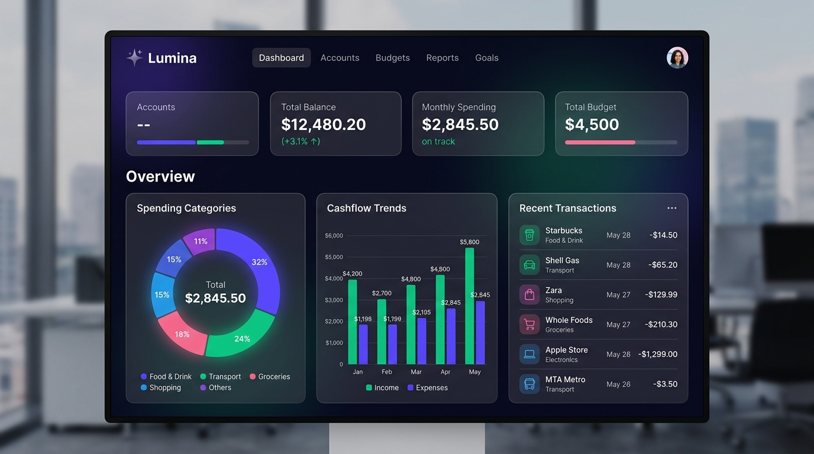

# Lumina Finance - Smart Expense & Budget Tracker

A modern, high-performance personal finance dashboard built with vanilla web technologies, responsive glassmorphic aesthetics, and client-side data persistence.



## ✨ Key Features

- **Dynamic Financial Overview (KPIs)**:
  - Real-time **Net Balance**, **Total Inflow**, and **Total Outflow**.
  - **Dynamic Savings Rate %** calculation.
  - Multi-currency switcher with live conversion display ($, €, £, ₹, ¥, C$).

- **Monthly Budget Ceiling & Meter**:
  - Live progress tracking toward your monthly spending budget.
  - Color-coded alerts: green (normal), amber warning (>80%), and critical pulse (>100%).
  - Inline custom budget target configuration.

- **Visual Data Analytics**:
  - **Cash Flow Dynamics**: Inflow vs. Outflow vs. Retained Capital bar chart.
  - **Spending by Category**: Donut chart with custom interactive legend and percentage breakdown.

- **Transaction Management**:
  - Add expense or income with quick preset chips (+10, +25, +50, +100, +500).
  - Search transactions instantly by description or category.
  - Filter by transaction type (All, Incomes, Expenses) or specific categories.
  - One-click deletion with undo/feedback toasts.

- **Privacy & Export**:
  - All records stored securely in your browser's `localStorage` (no accounts or external tracking required).
  - One-click **Export to CSV** for spreadsheet integration (Excel, Google Sheets).
  - One-click **Reset Demo Data** button to quickly test or showcase the app.

- **Aesthetic Excellence**:
  - Glassmorphic dark theme with ambient glowing gradients.
  - Clean light mode toggle.
  - Fully responsive on mobile, tablet, and desktop viewports.

## 🚀 Getting Started

To run locally:
```bash
node server.js
```

Then open your browser at:
```
http://localhost:3000
```

## 📁 File Structure

- `index.html`: Semantic HTML5 markup, accessibility attributes, and modal dialogs.
- `styles.css`: Design system tokens, glassmorphism cards, responsive grid, animations.
- `app.js`: State management, Chart.js integrations, filters, and local persistence.
- `server.js`: Zero-dependency static file server.
